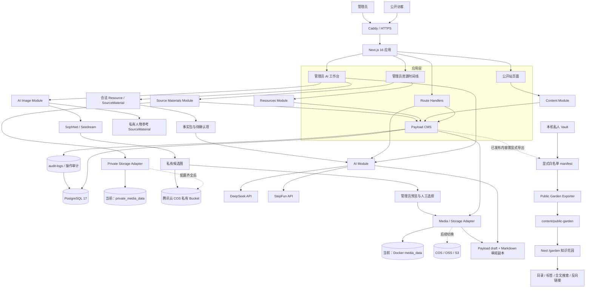

# Snorlaxden 数字花园

Snorlaxden 是何海钊的个人数字空间：公开个人品牌站、文章与项目、可控公开的 Obsidian 知识花园、私人资源库，以及后续可选的 AI 创作辅助。

**Sprint 0–3、COS 私有存储、生产恢复基线与 ISSUE-010/014 AI 内容生产链路已完成**。项目已经具备管理员访问控制、内容模型、草稿/发布/撤回、响应式公开站、AI 助手、默认私有的第二知识仓库、受保护的私有材料、可搜索且可撤回的公开知识花园，以及文字草稿和文章封面工作台。执行状态、依赖与验收项统一记录在 [TODO.md](TODO.md)。

生产站运行在 https://blog.snorlaxden.fun，后台入口为 https://blog.snorlaxden.fun/admin。

## 技术栈

- Node.js `22.23.4`（本机最低兼容 `20.18.1`）
- pnpm `10.x`
- Next.js `16.3.3`
- Payload CMS `3.91.0`
- PostgreSQL `17`
- Docker Compose
- Quartz 5：Sprint 3 借鉴其公开知识花园能力，不直接读取私人 Obsidian Vault
- Memos：仅借鉴时间线、标签、可见性和快速记录交互，不额外部署其 Go 服务

依赖使用精确版本和 lockfile。Payload `3.92.0` 已提高 Node 最低版本，本项目暂时锁定 `3.91.0`，升级前必须重新执行完整检查。

## 整体架构



关键边界：Next.js 负责页面和 HTTP；Payload 负责认证、内容模型与访问控制；PostgreSQL 是正式结构化内容的唯一真源；上传文件通过 Storage Adapter 管理；AI 只生成待审核草稿；公开花园只读取 manifest 点名且 checksum 匹配的白名单导出副本。

详细开发、模块、内容和对象存储标准见 [DX 文档](docs/DX.md)。
外部服务凭证的非敏感登记、验证状态和轮换规则见 [凭证登记](docs/operations/CREDENTIALS.md)；真实凭证只保存在被 Git 忽略的 `.secrets/` 或 `.env` 中。

## 本地运行

前置条件：Node、pnpm 和 Docker Desktop。

```bash
git clone https://github.com/bseazh/Snorlaxden.git
cd Snorlaxden
cp .env.example .env
```

为 `PAYLOAD_SECRET` 生成随机值，并在本机 `.env` 中填写；真实 `.env` 已被 Git 忽略，禁止提交。

```bash
openssl rand -hex 32
pnpm install --frozen-lockfile
pnpm dev:db
pnpm dev
```

访问：

- 网站：`http://localhost:3000`
- Payload 后台：`http://localhost:3000/admin`
- 私人资源库：`http://localhost:3000/library`（未登录会跳转后台登录）

第一次打开后台时创建本地管理员。开发账户和数据库不得直接用于生产环境。

首次安装或 schema 更新后执行迁移和首批内容导入：

```bash
pnpm payload migrate
pnpm seed
```

`pnpm seed` 仅在首批内容不存在时写入个人资料、3 个项目、3 篇文章和 6 个 FAQ。生产 Compose 会在 Web 启动前按顺序运行 migration 与 seed。

停止本地数据库：

```bash
pnpm dev:db:down
```

## 环境变量与密钥

真实密钥只允许存在于本机和服务器的 `.env`，权限应为 `600`。仓库只提交 `.env.example`。

| 变量 | 用途 | 当前阶段 |
|---|---|---|
| `DATABASE_URL` | Payload PostgreSQL 连接 | 已使用 |
| `PAYLOAD_SECRET` | Payload 会话及签名 | 已使用 |
| `NEXT_PUBLIC_SERVER_URL` | 站点公开地址 | 已使用 |
| `STEPFUN_API_KEY` | 阶跃星辰服务端密钥 | 已接入，当前账号额度不足 |
| `STEPFUN_BASE_URL` | `https://api.stepfun.com/v1` | 已配置 |
| `STEPFUN_MODEL` | 阶跃星辰模型，可按账号权限调整 | 已配置 |
| `DEEPSEEK_API_KEY` | DeepSeek 服务端密钥 | 已接入并完成真实生成 |
| `DEEPSEEK_BASE_URL` | `https://api.deepseek.com` | 已配置 |
| `DEEPSEEK_MODEL` | DeepSeek 模型，可按账号权限调整 | 已配置 |
| `AI_*_ENABLED` | AI 能力开关 | 模板默认关闭，生产仅启用文本试运行 |
| `AI_DAILY_LIMIT` | 每位管理员每日 AI 调用上限 | 已使用，默认 20 |
| `AI_IMAGE_ENABLED` | 是否启用管理员封面生成 | 模板默认关闭；生产启用前必须完成 Provider 与私有存储配置 |
| `AI_IMAGE_PROVIDER` | 图片 Provider 标识 | 当前为 `sophnet` |
| `AI_IMAGE_BASE_URL` | SophNet 图片接口 | 已配置固定 HTTPS endpoint |
| `AI_IMAGE_API_KEY` | SophNet 服务端密钥 | 只存在于本机和服务器 `.env`，禁止提交 Git |
| `AI_IMAGE_MODEL` | 图片模型 | 当前为 `Doubao-Seedream-5.0-pro` |
| `AI_IMAGE_DOWNLOAD_HOSTS` | Provider 返回图片的下载主机白名单 | 已启用，防止任意 URL/SSRF |
| `AI_IMAGE_DAILY_LIMIT` | 每位管理员每日图片真实调用上限 | 已使用，默认 8 |
| `PUBLIC_AI_ENABLED` | 是否开放访客自由问答 | 生产按需启用；预设问答不受影响 |
| `PUBLIC_AI_DAILY_LIMIT` | 每个访客 IP 摘要的每日自由问答上限 | 已使用，默认 10 |
| `AUDIT_IP_HASH_SALT` | 审计日志 IP 摘要盐 | 已使用，生产必须设置随机值 |
| `CONTENT_EXPORT_DIR` | 私有 Markdown 导出根目录 | 已使用；生产为 `/app/content-data/exports` |
| `STORAGE_DRIVER` | `local` 或 `cos` 私有存储选择 | 本地可用 `local`；生产为 `cos` |
| `STORAGE_LOCAL_DIR` | 本地私有原件目录 | local 模式使用；生产保留 `/app/private-files` 作为回滚卷 |
| `COS_BUCKET` | 腾讯云 COS Bucket | 已使用 `digital-1486267453` |
| `COS_REGION` | COS 地域 | 已确认 `ap-guangzhou` |
| `COS_SECRET_ID`、`COS_SECRET_KEY` | COS 服务端凭证 | 已配置于本机和服务器私密环境，禁止提交 Git |
| `PUBLIC_GARDEN_SOURCE_DIR` | 私人 Vault 或受控 Markdown 来源根目录 | 只在执行导出的环境配置，不进入 Git |
| `PUBLIC_GARDEN_MANIFEST` | 实际白名单 manifest 的路径 | 只在执行导出的环境配置，不进入 Git |
| `PUBLIC_GARDEN_OUTPUT_DIR` | `/garden` 唯一可读的公开副本目录 | 默认 `content/public-garden`；生产 `/app/public-garden` |

AI 密钥不会使用 `NEXT_PUBLIC_` 前缀，也不会发送到浏览器。管理员登录后可访问 `/studio`，选择具有个人笔记、本人所有或明确授权文字的 Resource/SourceMaterial，也可补充本次个人笔记。服务端会再次验证来源，且不会把 PDF/图片原始字节发送给模型。

工作流先生成“已有事实、缺失信息、待人工确认内容、允许引用来源”事实包，再据此生成结构化文章草稿。`ai-generations` 保存任务状态、当前步骤、事实包、来源关系、重试次数和实际模型调用次数；第二步失败时可以沿用已成功的事实包重试，不重复消耗第一步。每日限额按真实模型调用次数计算。成功结果只能由管理员点击“保存草稿”后写入 Payload draft 和 `content/articles/<slug>.md` 审阅副本；系统没有自动发布路径。

管理员登录后可访问 `/studio/images`。图片工作台只列出本人拥有或明确获授权的私有图片 SourceMaterial 和本人文章 draft；`article-cover-character-v1` 只使用文章标题、摘要、人工视觉要求和受控人物参考图，不发送 PDF、来源正文或私人笔记。SophNet 临时 URL 必须通过 HTTPS 主机白名单、大小、MIME 和图片解码校验，随后转存到 `private/ai-image-candidates/` 私有 COS；匿名访问返回 401 且响应 `private, no-store`。只有管理员人工选择的图片才进入私有 Media 并绑定 draft，仍不会自动发布。

公开站通过独立的 `/assistant` 页面提供数字花园助手，访客从主导航进入后直接看到完整会话区。预设问题直接读取已启用 FAQ，不调用模型；自由问题只把匿名访问可见的站点设置、已发布文章和项目发送给 DeepSeek，并返回站内引用。访客按加盐 IP 摘要限制每日调用次数，审计只保存问题的加盐摘要、字符数、模型和调用结果，不保存完整对话。模型不可用或超限时，预设问答仍可继续使用。

官方 API 文档：

- 阶跃星辰 Chat Completions：https://platform.stepfun.com/docs/zh/api-reference/chat/chat-completion-create
- DeepSeek API：https://api-docs.deepseek.com/

## 开发、GitHub 与服务器流程

项目采用这一条发布链路：

```text
本地开发和测试
  -> Git commit / push
  -> GitHub main
  -> 服务器拉取固定 commit
  -> Docker Compose 构建
  -> Caddy 反向代理
```

不要直接在生产服务器改业务代码。服务器只保存运行时 `.env`、数据库和媒体数据，这些内容都不进入 GitHub。

服务器部署位置：

```text
/home/ubuntu/Project/snorlaxden/app
```

服务器已经运行 systemd Caddy，因此本项目生产 Web 服务固定绑定 `127.0.0.1:3999`，本地开发仍使用 `3000`。正式访问链路为 `blog.snorlaxden.fun -> Caddy -> 127.0.0.1:3999`；`3999` 只用于服务器本机健康检查。域名接入将 `infra/Caddyfile.snorlaxden` 合并到服务器现有 `/etc/caddy/Caddyfile`，不覆盖其他站点，也不启动第二个公网反向代理。

生产镜像通过腾讯云镜像代理 `mirror.ccs.tencentyun.com` 拉取，并在 `Dockerfile` 与 `compose.production.yaml` 中固定镜像摘要，避免 Docker Hub 连接超时及镜像标签漂移。

生产部署命令：

```bash
cd /home/ubuntu/Project/snorlaxden/app
git pull --ff-only origin main
docker compose -f compose.production.yaml up -d --build
```

生产 `DATABASE_URL` 的主机名必须使用 Compose 服务名 `db`，不能使用 `127.0.0.1`。

### 生产备份与健康检查

生产已启用两组 systemd timer：每日生成同批次 PostgreSQL/媒体/内容/公开花园/COS 清单备份，每 15 分钟检查 Web、数据库、COS、容器重启、磁盘、证书和备份新鲜度。备份在本地临时目录完成 SHA-256 后加密，服务器滚动保留 14 天，并上传到私有 COS `private/backups/<batch>/`；备份口令只存在于本机与服务器 `.secrets/backup/backup.env`。

2026-10-26 已完成 T018 隔离恢复演练：一次性 PostgreSQL 容器恢复成功，核心表计数和管理员记录一致，四类文件归档均可提取，临时明文和恢复容器已清理。完整操作、故障恢复和敏感内容回滚边界见 [生产备份、恢复与回滚手册](docs/operations/BACKUP-RESTORE.md)。

当前限制：加密副本虽已离开服务器进入 COS，但仍与原件位于同一腾讯云账号和 Bucket，尚不能覆盖账号级故障；systemd 能产生失败状态与 journald 记录，但用户尚未提供短信、邮件或企业微信接收端，因此没有外部告警送达。

T020 已完成：站点所有者确认备案号为 `粤ICP备2026035659号`，生产域名、HTTPS、证书 SAN/有效期和页脚备案公示均已验证。备案号链接至工信部备案系统；工信部公开查询入口在本次独立复核时返回防护页，因此验收依据明确记录为“所有者提供的正式备案号 + 生产公示与技术链路实测”，不冒充独立主体查询结果。公安联网备案是否适用及办理时限仍按属地要求由站点所有者核对。

## 内容与文件位置

| 数据 | 权威位置 | 当前物理位置 |
|---|---|---|
| 正式文章 | Payload `posts` | PostgreSQL |
| 私人资源、短记与来源关系 | Payload `resources` | PostgreSQL，仅管理员可见；入口 `/library` |
| 私有来源材料、授权与文件元数据 | Payload `source-materials` | PostgreSQL，仅管理员可见；入口 `/library` |
| 私有 PDF/图片原件 | Private Storage Adapter | 本地默认 `.private-files/`；生产腾讯云私有 COS；local 卷保留用于回滚 |
| AI 生成任务、事实包与来源关系 | Payload `ai-generations` | PostgreSQL，仅管理员可见；状态与分步结果可恢复 |
| AI 图片任务、调用用量和候选元数据 | Payload `ai-image-generations` | PostgreSQL，仅管理员可见；幂等与失败重试 |
| AI 私有候选封面 | Image Candidate Storage | 生产 COS `private/ai-image-candidates/`；禁止公开直链 |
| 操作审计日志 | Payload `audit-logs` | PostgreSQL，管理员只读且禁止修改/删除 |
| AI 保存的 Markdown 草稿 | 非权威审阅副本 | 本地 `content/articles/<slug>.md`；生产 `/app/content-data/articles/<slug>.md` |
| 项目、FAQ、标签、设置 | Payload Collections/Global | PostgreSQL |
| 待导入 Markdown | 非权威工作副本 | `content/inbox/`，默认不进 Git |
| 私有 Markdown 导出 | 生成产物 | `content/exports/resources/`、`content/exports/source-materials/`，默认不进 Git |
| 公开花园副本 | 白名单构建产物 | `content/public-garden/`，默认不进 Git；生产挂载 `/app/public-garden` |
| 上传媒体 | Payload `media` + 文件存储 | 本地 `media/`；生产 `/app/media` volume |
| 构建期公开图片 | Git 管理的静态资产 | `public/images/` |
| AI Prompt | 版本化代码 | `src/modules/ai/prompts/` |
| AI 图片 Prompt | 版本化代码 | `src/modules/ai-images/prompts/` |

文章不能同时以 PostgreSQL 和 Markdown 作为正式来源。所有新文章先进入 Payload draft；`content/articles/` 是便于人工审阅、版本比较和后续导入导出的 Markdown 工作副本，不决定公开状态。来源材料导出固定标记 `visibility: private`，并区分个人笔记、来源说明、授权说明和已授权文字。生产目录由 `content_data` Docker volume 持久化。

腾讯云 COS Bucket `digital-1486267453` 和 Region `ap-guangzhou` 已接入官方 SDK Adapter。API 凭证只保存于本机和服务器的私密目录及 `.env`；应用级回归覆盖 Put、Head、Get、SHA-256、Delete 和删除后不可读。生产使用 `STORAGE_DRIVER=cos`，下载仍由应用先执行管理员鉴权，不暴露 Bucket URL 或持久签名 URL。生产盘点无历史 local 来源材料；代码按记录的实际 driver 双轨读取，local 卷暂时保留供回滚。详情见 [凭证登记](docs/operations/CREDENTIALS.md)。

## 公开花园白名单导出

ISSUE-007 使用三重公开条件：来源路径必须进入显式 manifest、笔记 frontmatter 必须同时声明 `publish: true` 和 `visibility: public`、每个附件必须单独声明授权依据及预期 SHA-256。实际私人 Vault 和实际 manifest 均不得提交 Git；可从 `content/templates/public-garden-manifest.json` 建立本机副本。

管理员端点 `POST /api/internal/public-garden/export` 只读取服务端环境变量中的固定路径，不接受请求方提交文件路径。导出器会移除非公开 frontmatter、把未公开笔记引用降级成不含标题的普通文字、拒绝未授权附件、危险协议、隐藏路径、路径穿越、原始 HTML 文件引用及 symlink。每次先生成全新临时目录和 `manifest.json`，审计成功后才保留原子切换结果；重新导出会删除撤回笔记和孤立附件。

`/garden` 使用 Next.js 原生页面实现 Quartz 风格的目录、Markdown、双链、反向链接、标签索引和全文搜索，不额外部署第二套 Quartz 站点。读取器先加载 `content/public-garden/manifest.json`，再只读取 manifest 点名、路径安全且 SHA-256 匹配的文件；目录中额外文件不会进入页面、搜索或 sitemap。公开附件通过 `/garden/files/*` 受控路由再次校验 manifest 与 checksum。

管理员完成公开导出后会失效整个 `/garden` 路由树。因为页面按请求读取当前原子目录、附件响应使用 `no-store`，撤回笔记或附件后旧 URL 立即返回 404，搜索结果、反向链接和 sitemap 同步消失。生产 Compose 将服务器 `content/public-garden/` 挂载到容器 `/app/public-garden`，导出与读取共享同一公开副本。

## 质量检查

```bash
pnpm typecheck
pnpm lint
pnpm test:int
pnpm build
```

端到端测试需要先启动数据库和应用，并安装 Playwright 浏览器。GitHub Actions 当前执行依赖安装、类型检查和 lint；数据库集成测试会在后续 CI 工作包中加入隔离的 PostgreSQL service。

## 目录

```text
src/app/                     Next.js 页面与 HTTP 边界
src/modules/                 AI、内容、资源与审计等业务模块
src/modules/source-materials/ 私有上传、存储、下载和 Markdown 导出
src/modules/ai-images/       图片 Provider、Prompt、限额、幂等、私有候选图与人工选图
src/modules/public-garden/  白名单校验、链接净化、原子公开导出与审计
src/collections/             Payload Collection Schema
src/migrations/              PostgreSQL 迁移
content/                     受控导入、导出与公开花园工作区
content/articles/            AI 保存的 Markdown 草稿工作副本
logs/                        日志统一入口、开发日志与受控运行日志导出
tests/                       集成测试与端到端测试
docs/DX.md                   开发、内容、媒体和对象存储标准
docs/operations/CREDENTIALS.md 外部服务凭证的非敏感登记与验证状态
docs/spec/                   v1.0 产品、架构、模块与验收规格
TODO.md                      当前 Sprint、任务依赖与验收清单
compose.yaml                 本地 PostgreSQL
compose.production.yaml      服务器 Web + PostgreSQL
Dockerfile                   生产应用镜像
infra/Caddyfile.snorlaxden   合并到服务器现有 Caddy 的本站配置片段
.env.example                 不含真实密钥的变量模板
```

## 安全边界

- 私人 Obsidian Vault 不进入本仓库或服务器；只发布白名单导出的副本。
- Resource、SourceMaterial、AI 产物和 Media 默认私密；`resources.visibility=public` 目前仅表示公开候选，不提供匿名读取。
- 资源 URL 仅保存 `http/https`，拒绝凭据、本机、内网、链路本地和云元数据目标；ISSUE-005 不会主动抓取外部地址。
- 用户、内容和媒体写操作仅允许已登录管理员；公开读取在 Payload access 层过滤。
- 文章和项目只有 `_status=published` 时对访客可见；撤回后详情返回 404。
- 来源材料仅允许文件头和声明 MIME 一致的 PDF、JPEG、PNG、WebP、AVIF，单文件限制 10MB，并按 SHA-256 去重。
- 私有原件不在 `public/`、`media/` 或 Markdown 目录；下载只走管理员接口，并返回 `private, no-store`、`nosniff` 和附件响应头。
- AI 只生成草稿，发布必须由管理员确认。
- 管理员登录、AI 调用、内容创建/修改/发布/撤回/删除写入不可变审计日志。
- 未获得合法字幕时，视频只能收藏链接、元数据和本人笔记。
- 数据库不开放公网端口；生产 Web 仅绑定服务器回环地址。
- 每次 schema 变更必须生成迁移，并提供备份与回滚方案。

完整需求从 [规格入口](docs/spec/README.md) 开始阅读。

## 日志与审计

统一入口见 [日志中心](logs/README.md)。开发过程按日期写入 `logs/development/` 并进入 Git；后台操作写入 PostgreSQL `audit-logs`；Docker 运行日志使用 10MB x 5 的轮转策略。管理员可在 `/admin/collections/audit-logs` 查询，或用 `pnpm logs:export` 导出到被 Git 忽略的 `logs/runtime/`。

审计日志不保存密码、Token、API Key、Cookie、正文或 AI 原始素材。客户端 IP 只保存加盐摘要。

## 参考项目与演进原则

本地的 `../quartz-5` 和 `../memos-main` 是后续迭代的参考实现。本站不重复造 Markdown、双链、搜索、时间线等已有成熟设计，也不会直接拼装两套完整产品。当前优先保持基础内容站、后台权限与发布流程稳定；可复用能力按照 [TODO.md](TODO.md) 的 Sprint 2/3 清单逐项移植、测试和上线。
