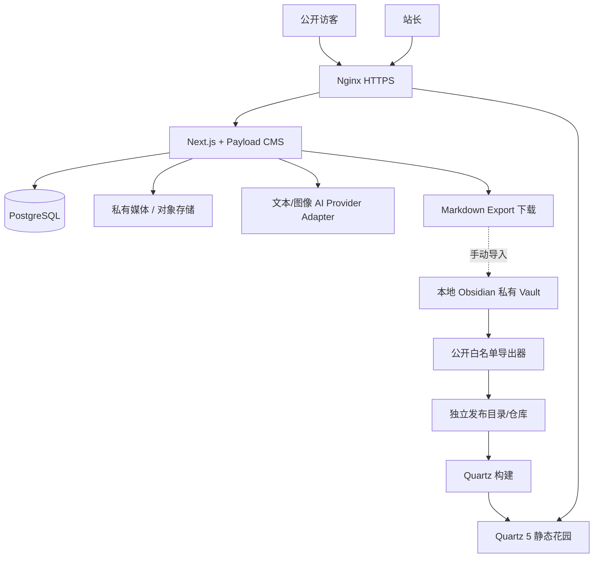

# 系统架构与数据流

## 1. 架构总览

## 2. 服务职责

| 服务 | 责任 | 不应承担 |
|---|---|---|
| `web` Next/Payload | 公开 CMS 页、管理员账号、业务 API、资源及草稿 | 保存整个私人 Vault |
| `postgres` | 文章、资源、问答、审稿和任务数据 | 直接替代本地 Obsidian |
| `garden` Quartz | 发布静态精选 Markdown、搜索/链接 | 登录管理私人笔记 |
| `public-exporter` | 从 Vault 的显式白名单导出 Markdown 与被授权附件 | 将 Vault 全量镜像到公网 |
| `AIProvider` | 按输入生成文本/图像 | 直接发布或取得私人资料的全量权限 |
| `media` | 私有/公开分区文件和元数据 | 无认证地暴露私有文件 |

## 3. 两条主要业务数据流

### 内容路径 A（原创）

`原始口述/照片（private SourceMaterial） → 事实清单 → 草稿 AI/人工编辑 → 文本结构化 Blocks → 配图任务/自有照片 → 排版预览 → admin publish → 文章公开 → Markdown export → Obsidian 收件箱（用户导入）`

### 内容路径 B（外部资料）

`B站/YouTube/视频号 URL → 规范化及来源识别 → metadata（官方允许则拉取） → Resource(private) → 授权字幕/自己观后笔记 → 知识卡（review） → 资源库检索 → 关联原创文章 → 审核公开 → 来源链接保留`

**重要**：`Resource` 卡片是私人第二仓库组成部分；不是把整段第三方视频转载在自己的站点。

## 4. 一致性与源头

- 知识笔记：Obsidian 主；`garden` 是可重建公开产物。
- 原创博客/项目：CMS 主；Markdown 下载是导出产物，可重复生成，不能自动覆盖 Vault 中同名文件。
- 资源与视频收藏：Resources 主；来源字段与提取时间不可抹去。
- AI 草稿：仅辅助数据；`postId` 上保留人工最终确认的版本，生成结果作为历史。
- 媒体：文件存储是原件源；CMS 存储引用与权限标签。

## 5. 按阶段安排的后台生成

**v1.0 P1**：单次任务的小文本请求可同步执行；图像生成支持 `queued → running → succeeded/failed` 任务状态（可能超过 HTTP 超时），保存可查询的生成记录。若暂不实现 worker，则禁用长任务按钮，避免伪装成已完成。

**v1.1**：独立 DB-backed Worker 轮询待执行任务，带幂等键/重试上限/超时/取消与审计，前台轮询状态；不强制首期部署 Redis。

## 6. 依赖与选型

- 使用正式兼容版本的 Node.js + Next.js + Payload、PostgreSQL、Nginx、Docker Compose。
- Git 负责源代码与精选笔记快照；CI 负责构建镜像/Quartz 静态站，生产服务器只拉取构建好的版本（如果 2C4G 内存紧张）。
- 公开主站与 `garden.<domain>` 用 HTTPS；数据库仅 Docker 内部网络，不开放 `5432`。
- 具体版本应依官方兼容矩阵选型，并固定 lockfile/镜像 digest；不可直接把一组未验证版本当成可部署清单。

## 7. 性能与故障边界

- AI API 超时：返回失败并保留原文，站长仍能手动编辑、上传图片、发布。
- 视频元数据拿不到：资源卡手动保存链接、标题、个人笔记。
- Quartz 构建失败：继续服务上一版本静态站，不用不完整构建覆盖目录。
- DB 宕机：公开 Quartz 静态站仍可访问；主站应降级/健康检查告警。
- 图片生成成功但保存失败：保留任务 ID、记录可回收的暂存文件，避免无限重复扣费。
